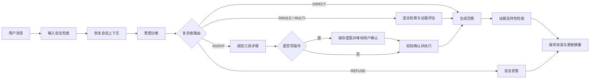

# LabMate · 高校共享仪器运维助手

LabMate 是面向高校共享仪器场景的 **Agentic RAG 应用**：它先识别用户意图，再按问题选择直接回答、知识检索、多轮补充检索、调用业务工具或拒答；涉及预约申请、故障登记等写操作时，系统先保存待确认提案，收到用户明确确认后才执行，并把结果写入本地业务库。

项目是一个 **单 Agent、多节点工作流**，不是多个独立 Agent 协作。知识库由公开资料摘要和项目自拟演示规则组成，设备、预约与工单均使用本地模拟数据，不连接真实学校的预约平台、设备遥测、身份认证或维修审批系统。

> **先看数据边界：** 30 篇活动 Markdown 中，24 篇为 AI 辅助编写的演示语料；其中 1 份重庆大学公开 PDF 仅作为预约资格参考原件。模拟设备状态和业务记录只用于展示流程。详见[资料来源与知识库清单](docs/labmate-sources.md)及[30 篇语料目录](docs/labmate-corpus.md)。

## 解决什么问题

普通 FAQ 只能回答规则，无法可靠衔接到业务动作。LabMate 将知识问答和受控的业务流程放进同一条状态化工作流中：

1. **识别与路由：** 分类器识别问候、制度、安全、设备、预约、报修及范围外请求；复杂度路由器选择 DIRECT、SINGLE、MULTI、AGENT 或 REFUSE。
2. **检索与回答：** 对 Markdown 知识做清洗、切块和元数据标注；BM25 负责词法召回，本地 BGE-small 可提供稠密向量召回，RRF 合并排名，Cross-Encoder 可对候选重排。回答附带资料引用，并经过证据支持性检查。
3. **工具与确认：** 只注册 LabMate 领域的设备查询、可预约时段检查、预约申请、故障工单和知识搜索等工具。写入动作会经过字段校验、权限检查、待确认状态持久化和显式确认。
4. **跨轮与恢复：** 会话消息、摘要、待确认动作和业务记录写入数据库；服务重建后可以恢复会话与未完成提案。幂等记录用于避免顺序重试重复写入。



## 主要能力与边界

| 能力 | 当前实现 | 运行边界 |
|---|---|---|
| 知识问答 | Markdown 导入、切块、BM25 / BGE 混合召回、RRF、Cross-Encoder、引用 | 本地 BGE 和 Cross-Encoder 权重需另行下载；无权重时可用哈希向量回退，但语义效果较弱 |
| 自适应检索 | SIMPLE/MULTI 路径、Self-RAG 证据充分性判断和追加检索 | 历史评测中的生成消融没有触发自纠错，不能据此声称自纠错带来额外收益 |
| 设备服务 | 演示设备查询、状态和日期时段占用检查 | 只读本地模拟数据库，不代表实时设备状态或已批准预约 |
| 预约与报修 | 建立待审核预约申请、登记故障工单 | 预约和工单均为演示记录；不自动批准预约、不执行真实维修 |
| 人工确认 | 写操作先形成提案，用户确认后服务端再次验证并执行 | 不提供校园身份认证；请求中的 user_id 不能作为生产身份凭据 |
| 会话记忆 | 对话历史、摘要、提案和写入状态持久化 | 有界历史与基础摘要，不等于无限长期记忆；多副本并发排他仍需加强 |
| 离线演示 | 未配置 DeepSeek 时切换到离线 provider；可关闭本地模型 | 离线模式用于启动和流程演示，回答质量不等于真实模型模式 |

## 技术栈

- **后端：** Python 3.11+、FastAPI、Pydantic、SQLAlchemy、SQLite（默认）/PostgreSQL、pytest
- **工作流：** LangGraph，一个 Agent 状态图，含意图分类、路由、检索、工具规划、确认执行、回答与记忆节点
- **RAG：** BM25、Sentence-Transformers `BAAI/bge-small-zh-v1.5`、RRF、Cross-Encoder `BAAI/bge-reranker-base`
- **模型：** DeepSeek Chat（可选，需用户自己的 API Key）；本地向量与重排模型（可选）
- **前端：** React、TypeScript、Vite，使用 SSE 接收流式回答
- **可选组件：** Redis 缓存、Qdrant 向量存储；默认本地配置可以使用进程内缓存和向量存储

## 本地运行

### 环境要求

- Python 3.11 或更新版本
- Node.js 20.19+ 或 22.12+
- Windows PowerShell 命令如下；macOS/Linux 可按相同依赖使用 venv 与 npm

### 1. 安装并启动 API

```powershell
python -m venv .venv
.\.venv\Scripts\python.exe -m pip install -e ".[dev]"
Copy-Item .env.example .env
```

`.env` 默认不包含任何密钥。先用轻量离线配置启动，不下载模型也不调用付费 API：

```powershell
$env:LOCAL_EMBEDDING_ENABLED = "false"
$env:CROSS_ENCODER_ENABLED = "false"
$env:UNSTRUCTURED_ENABLED = "false"
New-Item -ItemType Directory -Force data/local | Out-Null
.\.venv\Scripts\python.exe -m uvicorn app.asgi:app --host 127.0.0.1 --port 8002
```

API 启动时会导入知识库并在非生产模式写入演示设备数据。数据库和向量缓存位于 `data/local/`，已被 Git 忽略。首次启动应允许导入依赖的时间。

### 2. 启动前端

在另一个 PowerShell 窗口运行：

```powershell
Set-Location frontend
npm ci
npm run dev
```

打开 <http://127.0.0.1:5173>。前端 Vite 配置会把 `/api` 请求代理到 `http://127.0.0.1:8002`。

试试这些问题：

- `预约大型共享仪器前通常要完成哪些培训？`
- `查一下 LAB-CF-01 的设备状态和位置`
- `查询 LAB-CF-01 在 2026-11-02 的预约时段`
- `LAB-CF-01 运行时持续振动，帮我登记报修`

预约/报修流程可展示提案与确认卡片；它们会写入本地 SQLite 演示库。请勿将模拟数据解释成学校实际记录。

### 3. 配置真实模型（可选）

在本机 `.env` 中自行填写 `DEEPSEEK_API_KEY`。不要把密钥写入源码、README、命令历史或 Git。没有密钥时 API 使用离线 provider。启用 BGE 与 Cross-Encoder 前安装额外依赖并下载模型：

```powershell
.\.venv\Scripts\python.exe -m pip install -e ".[dev,rerank]" -c constraints-models.txt
.\.venv\Scripts\python.exe scripts/prepare_models.py --endpoint https://hf-mirror.com
```

随后确保 `.env` 中的 `LOCAL_EMBEDDING_ENABLED=true`、`CROSS_ENCODER_ENABLED=true`，并按需设置模型目录、设备与镜像。权重保存在 `data/local/`，不会提交到仓库。真实模型和评测说明见[模型运行与复现](docs/20-model-runtime-and-eval.md)。

## API 与检查入口

启动 API 后：

- Swagger：<http://127.0.0.1:8002/docs>
- 存活探针：`GET /api/v1/health`
- 就绪状态：`GET /api/v1/ready`
- 实际后端能力：`GET /api/v1/capabilities`
- 流式聊天：`POST /api/v1/chat/stream`
- 非流式聊天：`POST /api/v1/chat`
- 管理员工具与技能目录：`GET /api/v1/admin/tools`、`GET /api/v1/admin/skills`（需要配置管理员 token）

`/capabilities` 会报告运行时选择的 LLM、embedding、重排器、向量库与缓存后端。轻量离线模式出现 `offline`、`hash` 或 `memory` 是预期的回退状态；不能仅凭 `.env` 的开关判断模型是否已实际加载。

## 测试与评测

不需要 DeepSeek 密钥即可运行单元、集成和 API 测试：

```powershell
.\.venv\Scripts\python.exe -m pytest -q
npm --prefix frontend test -- --run
npm --prefix frontend run build
```

评测题集在 `eval/dataset/labmate/`，冻结的原始任务报告在 `eval/reports/`；详细指标、公式、类别分布、逐题结果与局限见[完整评测报告](docs/14-evaluation-report.md)，汇总见[简明实测记录](eval/LABMATE_MEASURED.md)。报告可离线重建：

```powershell
..\.venv\Scripts\python.exe scripts/build-evaluation-docs.py
```

### 已保存的模型评测结果

以下数据测量于 **2026-10-31**。它们是固定开发回归集上的历史结果。原始报告保留该次测量时的代码、输入、依赖和模型哈希；本公开版后来完成了代码裁剪和发布验证，**本表不是对当前发布源码重新运行模型后得到的结果**。要重新得到真实模型指标需准备模型权重、配置 API Key 并运行评测，这会产生 DeepSeek API 费用。

| 任务 | 保存结果 | 口径 |
|---|---:|---|
| 意图分类 | DeepSeek 119/120（99.17%）；规则 100/120（83.33%） | 120 道、9 类，提示与实现经此开发回归题调试；覆盖层开关本轮准确率相同 |
| 检索 | BM25 P@1 68.00%；BGE 69.33%；BM25+BGE+RRF 73.33%；混合候选+Cross-Encoder 78.67% | 75 道题、30 篇活动资料；CE 路线候选池为 8→5，其余路线取 5，不能把差值全归于 CE |
| 生成 | RAG 忠实度 100%；严格关键词命中 66/75（88.00%） | 同一个 DeepSeek 生成并作裁判；自检未触发纠错，因此没有测出纠错增益 |
| 端到端 | 32/32 场景通过、51/51 请求完成 | 包含确认、数据库写入、重复请求、跨轮和服务重建；断言是预设关键词与状态检查，不是独立人工验收 |

数据由项目开发者 AI 辅助整理，并在修复过程中反复使用；不是独立留出集、真实校园用户研究或生产 SLA。语料和模拟设备也限制了结果外推。严谨的解读与失败明细见[评测报告](docs/14-evaluation-report.md)及[限制说明](docs/12-limitations.md)。

## 目录结构

```text
app/                     FastAPI、Agent 图、RAG、工具、记忆与持久化
frontend/                React + TypeScript 聊天界面
knowledge/labops/        30 篇活动 Markdown 与公开参考原件
eval/dataset/labmate/    意图、检索/生成、端到端题集
eval/reports/            固定的历史模型任务报告与完整汇总
tests/                   单元、集成与 API 测试
docs/                    架构、语料来源、评测与面试说明
scripts/                 模型准备、知识导入、评测和报告生成
```


## 许可与来源

本仓库保留 MIT License 和原版权声明。项目最初使用的通用工程结构和部分通用实现参考了 [JEen-wang/Adaptive-rag](https://github.com/JEen-wang/Adaptive-rag)；该来源及处理方式见[归属说明](docs/attribution.md)。LabMate 场景语料、业务流程和发布说明应按本仓库明确披露的来源与模拟边界理解。
